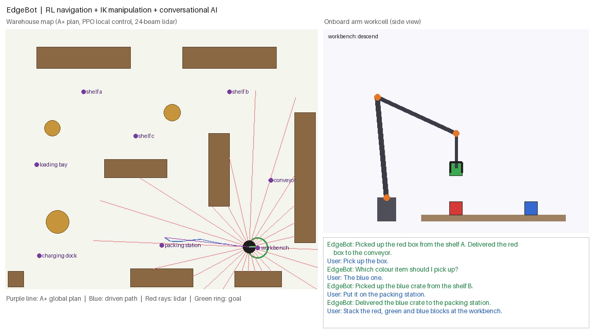
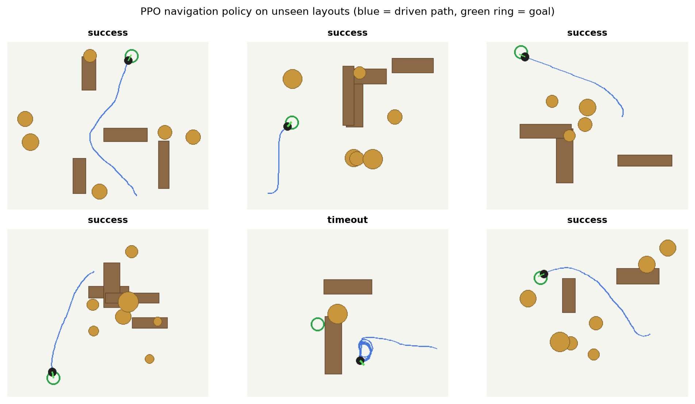

# EdgeBot

**A voice-commanded warehouse mobile manipulator: reinforcement learning for navigation, inverse kinematics for manipulation and conversational AI for interaction, exported for edge devices.**

Course project for **UCS760 – Edge AI and Robotics: Reinforcement Learning & Conversational AI**, by Mehul Khanna.



You say *"move the red box from shelf A to the conveyor"*. EdgeBot transcribes it with Whisper and parses it into an intent and slots with a distilled BERT-style network. A dialogue manager checks the request against the robot's state. The JetBot-style robot then plans a route with A*, drives it with a PPO policy that reads a 24-beam lidar, picks the box with a 3-DOF arm (closed-form IK, minimum-jerk trajectories, PD control), drives on, places the box and replies in a neural TTS voice.

| Deliverable | Location |
|---|---|
| Project report (13 pages) | [`docs/report.pdf`](docs/report.pdf) |
| Presentation slides (14 slides) | [`docs/slides.pdf`](docs/slides.pdf) |
| End-to-end demo video | [`results/media/edgebot_demo.mp4`](results/media/edgebot_demo.mp4) |
| Manipulation lab animation | [`results/media/manipulation_demo.gif`](results/media/manipulation_demo.gif) |
| Spoken commands and replies | [`results/demo/`](results/demo) |
| Every metric, as JSON | [`results/`](results) |

---

## Syllabus coverage

| Syllabus unit / lab | Where it lives | What is measured |
|---|---|---|
| MDP, Bellman optimality, Dynamic Programming | `edgebot/envs/warehouse_grid.py`, `edgebot/rl/tabular.py` | Value vs. policy iteration, deterministic and slippery floors |
| Monte Carlo, TD: SARSA, Q-learning, Expected SARSA, n-step, Double Q | `edgebot/rl/tabular.py` | 20-seed learning curves, safe vs. optimal routes, TD(0) prediction vs. DP |
| OpenAI Gym, RL in continuous spaces, function approximation | `edgebot/envs/jetbot_nav.py` (Gymnasium API), `edgebot/rl/ppo.py` | PPO with a Gaussian policy on 300 unseen layouts |
| Deep RL, DQN, RL for vision | `edgebot/rl/dqn.py`, `edgebot/rl/networks.py` | Double Dueling DQN from lidar and from 64×64 egocentric images |
| Manipulation, IK and control, gripping | `edgebot/manipulation/arm.py`, `edgebot/manipulation/workcell.py` | IK accuracy and speed, joint tracking, grasp tolerance |
| **Lab:** Pick-n-place, Object assembly | `Workcell.pick_and_place`, `Workcell.stack` | 100 randomised trials each, robustness to encoder noise |
| Task learning | `edgebot/manipulation/reach_env.py` | PPO reaching vs. analytic IK |
| **Lab:** Game agent, JetBot in simulation | `edgebot/envs/jetbot_nav.py` | Training curves, held-out evaluation |
| NLP, BERT, intent slot filling, token classification | `edgebot/nlu/` | Unseen sentence templates, ASR-noise robustness |
| ASR (Jasper / QuartzNet / CitriNet family) | `edgebot/speech/asr.py` | WER under noise, real-time factor on GPU and CPU |
| TTS (Tacotron2 / WaveGlow family) | `edgebot/speech/tts.py` | Real-time factor; generates the robot's spoken replies |
| **Lab:** Conversational VoiceBot (JetBot commands / feedback) | `edgebot/robot/agent.py`, `scripts/run_demo.py` | Multi-turn voice missions with clarification and context |
| GPU computing, deployment on Jetson | `edgebot/edge/export.py`, `scripts/export_edge.py` | ONNX export, INT8 quantisation, latency, size, accuracy |

## Architecture

```
 speech ──► ASR (Whisper, CTranslate2) ──► NLU (JointBERT-mini, ONNX) ──► dialogue manager
                                                                              │
 spoken reply ◄── TTS (Piper VITS, ONNX) ◄── feedback ◄── task planner ◄──────┘
                                                              │
                         ┌────────────────────────────────────┴───────────────────┐
                 navigation: A* global plan                         manipulation: closed-form IK
                 + PPO local policy (ONNX, lidar)                   + min-jerk trajectories + PD control
```

Navigation is hierarchical. A* over an inflated occupancy grid supplies waypoints, and the learned policy tracks them while reacting to obstacles. Manipulation uses exact kinematics. The design rule is to learn what is hard to model (unknown clutter) and compute what is known exactly (arm geometry). The arm-reaching study measures that trade-off.

## Results

All numbers come from the scripts below and are stored in `results/*.json`. The tables in the report are generated from those files.

### Reinforcement learning on the warehouse MDP

| Algorithm | Online return (last 100 ep.) | Greedy return (median) | Greedy reaches goal |
|---|---:|---:|---:|
| Monte Carlo (first-visit) | −97.4 | −17 | 65% |
| SARSA | −26.0 | −17 | 80% |
| Expected SARSA | −17.8 | −13 | 100% |
| Q-learning | −41.2 | **−11 (optimal)** | 100% |
| Double Q-learning | −22.3 | −17 | 100% |
| 4-step SARSA | −21.8 | −17 | 95% |

Value and policy iteration agree to 1e-8. On a slippery floor the optimal policy keeps one row away from the oil spill. Q-learning learns the optimal edge route but earns poor online reward while exploring. SARSA learns the safe route. This is the on-policy vs. off-policy result from Sutton & Barto, Fig. 6.4.

### JetBot navigation (300 unseen random warehouses)

| Algorithm | Observation | Actions | Steps | Success | Collision | Timeout | Path efficiency |
|---|---|---|---:|---:|---:|---:|---:|
| **PPO (deployed)** | lidar | continuous | 5.0M | **96.0%** | 2.0% | 2.0% | 0.96 |
| PPO | lidar | discrete | 3.0M | 96.3% | 2.3% | 1.3% | 0.88 |
| Double Dueling DQN | lidar | discrete | 1.0M | 86.0% | 10.0% | 4.0% | 0.95 |
| Double Dueling DQN | pixels (CNN) | discrete | 1.0M | 83.7% | 1.0% | 15.3% | 0.91 |



### Manipulation

| Task | Trials | Success | Notes |
|---|---:|---:|---|
| Pick-n-place | 100 | **100%** | joint tracking RMSE 0.19° |
| 3-block assembly (random order) | 100 | **100%** | grasp tolerance 12 mm, gravity on release |
| RL reaching (PPO) | 500 | 100% | 0.46 s, 5.1 mm mean error (analytic IK: exact) |

Closed-form IK is exact to 1e-16 m in 44 µs. Damped least squares takes 88 iterations and 4.4 ms. Success stays at 100% up to 1° of joint-encoder noise and collapses at 4°.

### Conversational AI

NLU accuracy on sentence templates never seen in training:

| Model | Params | Intent acc. | Slot F1 | Frame acc. | Intent (ASR noise) |
|---|---:|---:|---:|---:|---:|
| Bag-of-Words + logistic regression | – | 93.3% | – | – | 92.6% |
| JointBERT-mini, trained from scratch | 0.32M | 93.9% | 99.0% | 91.4% | 92.1% |
| JointBERT, DistilBERT fine-tuned (teacher) | 66.4M | 99.9% | 100.0% | 99.9% | 99.4% |
| **JointBERT-mini, distilled (deployed)** | **0.49M** | **97.6%** | **99.3%** | **97.6%** | **97.1%** |

Distillation used masked-language-model augmentation (TinyBERT-style): 42,828 extra utterances, soft-labelled by the teacher.

Speech in the loop: 150 held-out commands, spoken by TTS, transcribed by Whisper-base and parsed by the NLU:

| Audio | WER | Intent acc. | Slot-value F1 | Frame acc. |
|---|---:|---:|---:|---:|
| Clean | 2.8% | 96.7% | 95.8% | 94.0% |
| 20 dB SNR | 3.0% | 96.0% | 96.8% | 94.7% |
| 10 dB SNR | 7.6% | 94.0% | 96.3% | 91.3% |

Whisper-base runs at a real-time factor of 0.078 on the GPU (FP16) and 0.50 on CPU (INT8). Piper TTS runs at 0.135 on CPU.

### Edge deployment (batch 1, single CPU thread)

| Model | Params | ONNX FP32 / INT8 | PyTorch CPU | PyTorch CUDA | ONNX RT FP32 | ONNX RT INT8 |
|---|---:|---:|---:|---:|---:|---:|
| PPO actor | 21k | 82 / 26 KB | 0.022 ms | 0.048 ms | **0.005 ms** | 0.006 ms |
| DQN CNN | 338k | 1322 / 341 KB | 0.187 ms | 0.131 ms | 0.072 ms | 0.249 ms |
| JointBERT-mini | 488k | 2180 / 751 KB | 0.676 ms | 0.748 ms | **0.215 ms** | 0.329 ms |

After INT8 quantisation:
- **PPO:** navigation success unchanged (95% → 95%).
- **NLU:** frame accuracy 97.6% → 97.5%.
- **Pixel DQN:** per-tensor dynamic INT8 drops success from 81% to 42%. Per-channel scales bring it back to 65%, and calibrated static per-channel QDQ (the format TensorRT uses) reaches 74%, which is also the fastest variant at 0.044 ms.

Latencies were measured on a laptop (RTX 4050 Laptop GPU, x86 CPU), not on Jetson hardware. The ONNX files in `checkpoints/onnx/` are the inputs for `trtexec` on a Jetson.

## Quick start

Python 3.10+ is required. A GPU is optional: everything runs on CPU, and the GPU only speeds up training and ASR.

```bash
git clone https://github.com/MrMehulkhanna/edgebot.git
```

```bash
cd edgebot && python -m venv .venv && source .venv/bin/activate
```

```bash
pip install -r requirements.txt
```

Trained models ship in `checkpoints/`, so the demo runs straight away. On first use, Whisper-base and the Piper voice download from the Hugging Face Hub and are cached.

```bash
python scripts/run_demo.py --voice --video results/media/edgebot_demo.mp4
```

Other ways to drive the robot:

```bash
python scripts/run_demo.py --interactive
```

```bash
python scripts/run_demo.py --text "stack the red green and blue blocks at the workbench" "what is your status"
```

```bash
python scripts/run_demo.py --wav results/demo/user_01.wav
```

```bash
pip install sounddevice && python scripts/run_demo.py --mic
```

Run the test suite (18 tests):

```bash
python -m pytest -q
```

## Reproducing every result

| Step | Command | Time (RTX 4050 laptop) |
|---|---|---|
| Tabular RL | `python scripts/run_tabular.py --runs 20` | ~3 min |
| PPO navigation | `python scripts/train_nav_ppo.py --steps 5000000` | ~25 min |
| PPO discrete | `python scripts/train_nav_ppo.py --steps 3000000 --action discrete` | ~18 min |
| DQN lidar / pixels | `python scripts/train_nav_dqn.py --obs lidar` · `--obs pixels` | ~37 / 42 min |
| Manipulation labs | `python scripts/run_manipulation.py --trials 100` | ~4 min |
| RL reaching | `python scripts/train_arm_reach.py` | ~12 min |
| NLU (scratch, BERT teacher, distillation) | `python scripts/train_nlu.py` | ~40 min |
| Edge export + benchmark | `python scripts/export_edge.py` | ~5 min |
| Speech evaluation | `python scripts/eval_voice.py --n 150` | ~4 min |
| Figures, tables, PDFs | `python scripts/make_figures.py && python scripts/build_tables.py && make report` | ~1 min |

`make all` runs the whole pipeline in order.

## Repository layout

```
edgebot/
  envs/          warehouse grid MDP, JetBot navigation environment (lidar / pixels)
  rl/            tabular DP / MC / TD, DQN, PPO, networks, evaluation
  manipulation/  DH kinematics, IK, trajectories, PD control, workcell, RL reaching env
  nlu/           data generator, JointBERT-mini, DistilBERT JointBERT, distillation
  speech/        Whisper ASR, Piper TTS, WER
  edge/          ONNX export, INT8 quantisation, ONNX Runtime wrappers
  robot/         warehouse layout, A* planner, dialogue manager + task executor
scripts/         training, evaluation, demo, figures, LaTeX tables
tests/           unit tests (MDP, DP/TD, lidar, collisions, planning, FK/IK/Jacobian, tasks, NLU, dialogue)
checkpoints/     trained PyTorch models and their ONNX / INT8 exports
results/         metrics (JSON), figures, demo video and audio
docs/            report and slides (LaTeX sources, generated tables, PDFs)
```

## Limitations

- The simulator is 2-D, with ideal kinematics and noise-free lidar, and the arm is planar. A physical JetBot would need sensor noise, latency modelling and domain randomisation for sim-to-real transfer.
- The speech evaluation uses one synthetic voice. Real speakers and far-field microphones will raise the WER.
- The NLU corpus is template-generated. The test split holds out whole sentence structures, but it is still synthetic.

## References

Sutton & Barto (2018) *Reinforcement Learning: An Introduction*; Mnih et al. (2015) DQN; van Hasselt et al. (2016) Double DQN; Wang et al. (2016) Dueling DQN; Schulman et al. (2017) PPO; Devlin et al. (2019) BERT; Sanh et al. (2019) DistilBERT; Chen et al. (2019) JointBERT; Jiao et al. (2020) TinyBERT; Radford et al. (2023) Whisper; Kim et al. (2021) VITS; Spong et al. (2006) *Robot Modeling and Control*. The full list is in the report.

## License

MIT. See [LICENSE](LICENSE).
